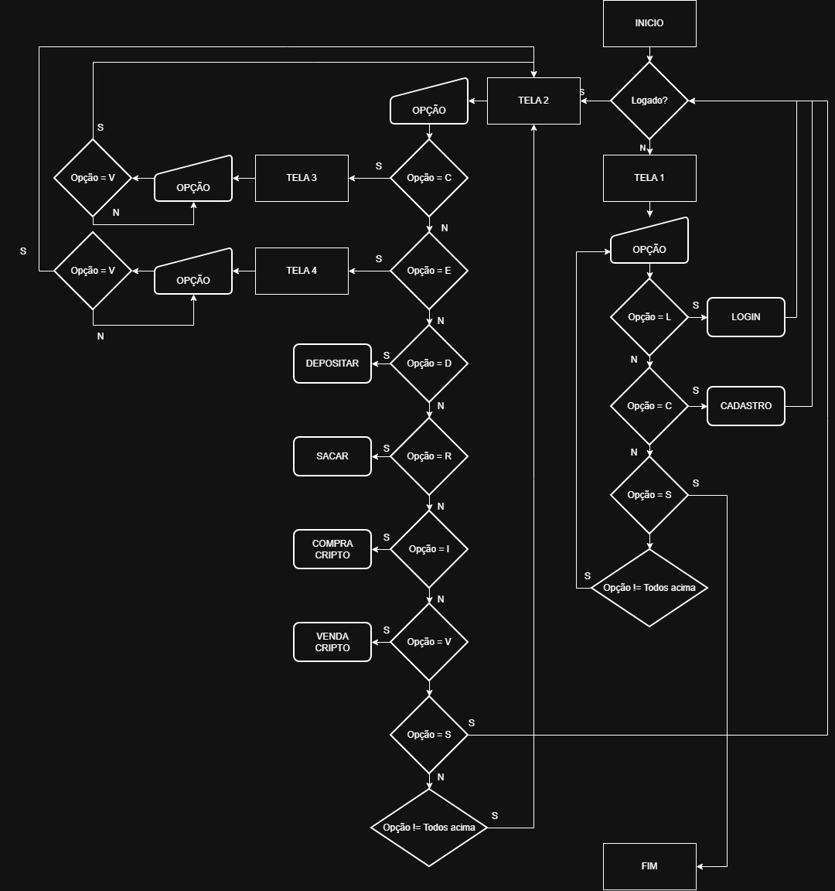

# FeiX-Change
O projeto FeiX-Change se trata de uma aplicação CLI desenvolvida em C para a disciplina de Desenvolvimento de Algoritmos do curso de Ciência da Computação do Centro Universitário FEI.  
A proposta do projeto é funcionar como uma "exchange de criptomoedas", permitindo que um usuário se cadastre, realize login, deposite e saque valor em reais, compre e venda valores em três criptomoedas: bitcoin, ethereum e ripple. Toda a base de dados da aplicação é construída com arquivos .txt.
## Funcionalidades
- Cadastro de usuário;
- Login de usuário;
- Depósito de valores persistidos em arquivo e associados ao usuário;
- Saque de valores persistidos em arquivo e associados ao usuário;
- Compra de criptomoedas aplicando taxa de compra e conversão de acordo com cotação, também persistido em arquivo;
- Venda de criptomoedas aplicando taxa de compra e conversão de acordo com cotação, também persistido em arquivo;
- Persistência de histórico de transações;
- Consulta de saldo do usuário;
- Consulta de extrato do usuário (histórico de transações);
- Atualizar cotações das moedas (caso a última atualização tenha ocorrido há mais de 24 horas, caso contrário informa o usuário).
## Regras de negócio
- Os saldos em reais são representados com duas casas decimais.
- As quantidades de criptomoedas são representadas com até oito casas decimais.
- As operações de compra e venda aplicam taxas específicas para cada criptomoeda.
- Não é permitido realizar saques ou compras sem saldo suficiente.
- Não é permitido vender uma quantidade superior à disponível na carteira.
- As cotações podem sofrer variações de até 5% para cima ou para baixo durante sua atualização.
## Criptomoedas disponíveis

| Criptomoeda | Sigla | Taxa de compra | Taxa de venda |
|---|---|---:|---:|
| Bitcoin | BTC | 2% | 3% |
| Ethereum | ETH | 1% | 2% |
| Ripple | XRP | 1% | 1% |

## Estrutura do projeto
Em branch main:
```text
FeiX-Change/
├── apps/           # Arquivos do fluxo principal da aplicação (.c)
├── include/        # Arquivos de cabeçalho (.h)
├── src/            # Módulos em C (.c)
├── data/           # Arquivos de armazenamento
├── Makefile        # Instruções de compilação
├── .gitignore
└── README.md
```
A branch devcpp altera essa estrutura removendo os diretórios e Makefile, mantendo somente os arquivos de cabeçalho e códigos fonte junto do arquivo .dev para fácil compilação no ambiente do Dev-C++.
## Diagramas
### Modelo ER


### Fluxograma


## Requisitos
- Compilador C compatível com o padrão utilizado no projeto.
- Sistema operacional compatível com os recursos implementados.
- Permissão de leitura e escrita no diretório de dados.

## Compilação e execução
### Branch main
1. Clone o repositório: 
```bash
git clone URL_DO_REPOSITORIO
```
2. Dentro do diretório, compile o projeto:
```bash
make
```
3. Execute:
```bash
./FeiX-Change
```
### Branch devcpp
1. Clone o repositório;
2. Abra o projeto .dev no Dev-C++;
3. Inclua os arquivos no projeto; 
4. Compile e rode;
## Releases
A [release do projeto](https://github.com/SRochaGabriel/feix-change/releases/tag/v1.0) é uma pasta compactada contendo o diretório de dados, o executável da aplicação e um atalho. O executável deve permanecer na mesma pasta que o diretório de dados, caso contrário será criado um novo diretório de dados no local de execução da aplicação.
## Referências
- [ASCII Art Archive — Text to ASCII Art](https://www.asciiart.eu/text-to-ascii-art): ferramenta alternativa para gerar texto em arte ASCII.
- [The entire table of ANSI color codes working in C! — RabaDabaDoba (GitHub Gist)](https://gist.github.com/RabaDabaDoba/145049536f815903c79944599c6f952a): tabela de códigos ANSI de cores com foco em C.
- [Guia definitivo: valores aleatórios em C — Galirows](http://galirows.com.br/meublog/programacao/guia-definitivo-valores-aleatorios-c/): material sobre geração de valores aleatórios em C.
- [Constants in C Explained — Bala Priya C, freeCodeCamp](https://www.freecodecamp.org/news/constants-in-c-explained-how-to-use-define-and-const-keyword): uso de `#define` e do qualificador `const` em C.
- [Microsoft Learn — `_stat` e funções relacionadas](https://learn.microsoft.com/en-us/cpp/c-runtime-library/reference/stat-functions?view=msvc-170): consulta de informações sobre arquivos na biblioteca de execução do C da Microsoft.
- [Microsoft Learn — `_mkdir` e `_wmkdir`](https://learn.microsoft.com/en-us/cpp/c-runtime-library/reference/mkdir-wmkdir?view=msvc-170): criação de diretórios na biblioteca de execução do C da Microsoft.
- [Playlist Curso: Dominando Estruturas de Dados 1 — Xavecoding](https://www.youtube.com/playlist?list=PL3ZslI15yo2r-gHJtjORRMRKMSNRpf7u5): Utilização de structs, organização de projetos e compilação com Makefile.
- [time.h header file in C with Examples — GeeksforGeeks](https://www.geeksforgeeks.org/c/time-h-header-file-in-c-with-examples/) — Referência sobre manipulação de datas e horários em C utilizando a biblioteca `time.h`.